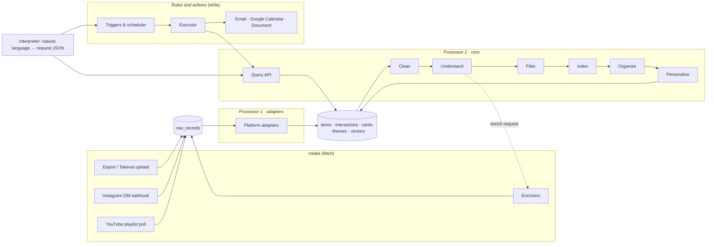

# 01 · Architecture

## Layers

| Layer | Job | Reads | Writes | Side effects allowed? |
| --- | --- | --- | --- | --- |
| **Intake** | Fetch data from platforms and enrichment providers, exactly as received | External platforms, uploads | `raw_records` | Only calls to fetch data |
| **Processor 1 · adapters** | Turn each platform's raw payloads into the shared Item and Interaction shapes | `raw_records` | `items`, `interactions`, `enrichments`, `own_accounts` (suggested) | No |
| **Processor 2 · core** | Clean, understand, filter, index, organize, personalize; answer queries | Core tables | Derived tables (cards, embeddings, themes, reports) | No |
| **Query API** | The processor's public face: JSON request in, JSON response out | Core + derived | Nothing (read-only), except caching | No |
| **Interpreter** | Turn natural language into a validated request or rule using the action registry | Registry, query vocabulary | Draft rules, requests | No (it proposes; the executor acts) |
| **Rules and actions** | Fire triggers, run processor queries, deliver results, keep placements in sync | Rules, query API | `rule_runs`, `deliveries`, `placements`, external tools | **Yes, only here** |

The two "processors" in founder conversations map to **Processor 1** (adapters: platform-specific → shared shape) and **Processor 2** (everything after, platform-agnostic).

## Boundaries that keep the work split cleanly

1. **`raw_records`** is the line between intake and the processor. Intake writes a payload exactly as received, with `source`, `kind` and `format_version`. Adapters read it. A platform format change shows up as a new `format_version`, never as silently wrong items.
2. **The query API** is the line between the processor and everything that uses it (interpreter, executor, later the hub and MCP). Request and response shapes live in `scrolldigest/schema/query.py`.
3. **The action registry** is the line between the interpreter and the executor. Every output action declares its name, parameters and side effects. The interpreter may only produce actions that are registered.

## Main flows

### A. History upload → first report

1. Client uploads the export zip straight to Supabase Storage (signed URL). The API records an `upload` and enqueues `upload.received`.
2. **Intake worker** opens the zip, extracts only the files we use (see `04-intake.md`), and writes one `raw_record` per entry (for DMs: one per shared post object, never message text). Enqueues `raw.batch_ready`.
3. **Adapter worker** turns raw records into Items and Interactions (dedup by `dedup_key`), runs own-account suggestion for DM threads. Enqueues `items.ingested` in priority order: shares and saves first, likes after.
4. **Processor worker** runs clean → embed → filter → info gate → incremental theme assignment (or first theme build) → trends → direction, writing derived rows with the current `processor_version`.
5. When saves and shares are done, the processor builds the **first report** (JSON) and enqueues `report.ready`. Likes and views continue in the background and update the report.

### B. Live capture (Instagram DM share)

1. Meta calls our webhook. The API verifies the signature, writes a `raw_record` (`source=instagram_dm`, `kind=share`) and replies within seconds. Enqueues `raw.received`.
2. Adapter → Item + Interaction(`share`, `audience=self` because the user sent it to us).
3. Processor processes that one item immediately (tier 0–1, plus tier 2 if it is thin and high value), assigns it to a theme, and checks it against active rule triggers.
4. Optional: the bot replies with a short confirmation (UX decision, see `06-rules-and-actions.md`).

### C. Request → rule → delivery

1. User types a request. The **interpreter** (LLM) compiles it into a `RuleDraft` JSON: `when` + `content` + `do`, using only registered actions and the query vocabulary. It is validated with Pydantic.
2. The user confirms a preview (rendered from what the rule *would* produce now).
3. The **scheduler** fires the rule (cron or input event). The **executor** calls the query API for `content`, removes items already delivered by this rule, renders, calls the action, records a `delivery` and any `placement`.

## Queues and jobs

Postgres-backed queues (Supabase Queues / `pgmq`). One queue per stage keeps priorities and retries simple.

| Queue | Producer | Consumer | Message |
| --- | --- | --- | --- |
| `intake.uploads` | API | intake worker | `{upload_id}` |
| `intake.enrich` | processor | intake enrichers | `{item_id, tier, reason}` |
| `adapt.raw` | intake | adapter worker | `{raw_record_ids[]}` |
| `process.items` | adapter | processor worker | `{item_ids[], priority}` |
| `rules.fire` | scheduler, processor (input-event triggers) | executor | `{rule_id, trigger_ref}` |

Every job is **idempotent** (safe to run twice), retried with backoff, and logs timing. A job never deletes raw data.

## Deployment (Proposed)

| Piece | Where |
| --- | --- |
| Postgres + pgvector, auth, file storage, queues | Supabase |
| FastAPI app (webhooks, uploads, query API) | Container host (Railway, Fly.io or Render) |
| Workers (intake, adapter, processor, executor) | Same image, different entrypoint, same host; scale processor workers independently |
| Large batch embedding (optional later) | Modal or a bigger worker |
| Scheduler | One lightweight process (APScheduler or cron) that enqueues `rules.fire` |

## Later layers (designed, not built yet)

- **Hub** (web app): reads `*_view` database views and calls the query API. Includes **vision boards** (Pinterest-style boards mixing media from every platform) backed by `boards` / `board_items` and the `similar` / `suggest_for_board` query ops, and **semantic search** over the user's whole history.
- **MCP server**: exposes `get_profile`, `get_context(task)`, `search`, `list_themes`, `get_items`, `what_changed`, `list_actions` and a few writes (`add_note`, `create_action`, `update_action`, `propose_goal_change`). Mostly database reads and query API calls; no LLM per request except an optional ranking pass in `get_context`.
- **Local-first desktop app** (Electron or Tauri): storage moves to a local database behind the same `db/` interface. Scheduled rules then need either the machine on or a small cloud relay.
